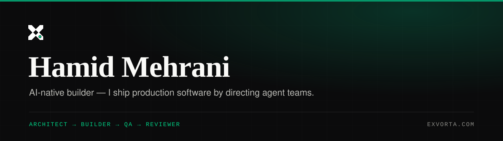

<p align="center">
  
</p>

<p align="center">
  <a href="https://exvorta.com"></a>
  <a href="https://linkedin.com/in/hamidmehrani"></a>
  <a href="mailto:hamid@exvorta.com"></a>
</p>

## Hi, I'm Hamid 👋

**AI-native builder.** I ship production software by directing AI agent teams —
architect → builder → QA → reviewer, automated quality gates, one-command
production landing.

I don't just prompt a model. I run an engineering pipeline where agents write
scoped diffs, every change passes a real gate (type-check, build, tests, diff
review), and shipping is a single command.

---

### 🚀 Proof of work

| Project | What it is | Stack |
|---|---|---|
| **[exvorta.com](https://exvorta.com)** · [repo](https://github.com/hamidmehrani/exvorta-main) | Live SaaS platform — built end-to-end by my agent pipeline | Next.js 15 · Payload CMS · PostgreSQL · Vercel |
| **LeadGen Machine** | Cold-outreach engine, 30+ modules. 48,000+ B2B leads processed across 21 countries; AI reply classification, self-learning message loop, anti-ban architecture | Python · Claude API · OpenAI API |
| **Website Audit Tool** | Puppeteer + Lighthouse + axe-core pipeline that turns any website into a client-ready proposal PDF | Node.js · Puppeteer · Lighthouse |
| **[firoza.ir](https://firoza.ir)** | Export business site I built and operate | Next.js · CMS |

---

### 🧠 How I work

```
spec → architect → parallel builders → automated QA gate → review → land
```

- **Architect** — interfaces, acceptance criteria, and a written blueprint first.
- **Builders** — parallel agents, one file per task, unified diffs only.
- **QA gate** — type-check, production build, tests, and diff review on every change.
- **Land** — one-command deploy, verified live, then documented.

---

### 🛠 What I work with

<p>
  
  
  
  
  
  
  
  
  
</p>

---

### 📊 GitHub

<p align="center">
  
  
</p>

---

### 🔭 Currently

Building **Exvorta Suite** — AI trade documents, shipment tracking, trade CRM,
and market intelligence for importers and exporters.

📫 **hamid@exvorta.com** · [LinkedIn](https://linkedin.com/in/hamidmehrani) · [exvorta.com](https://exvorta.com)
